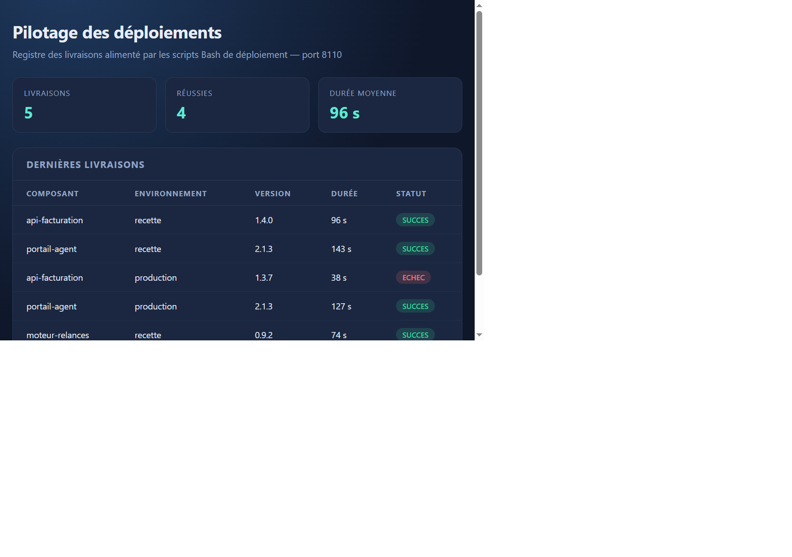
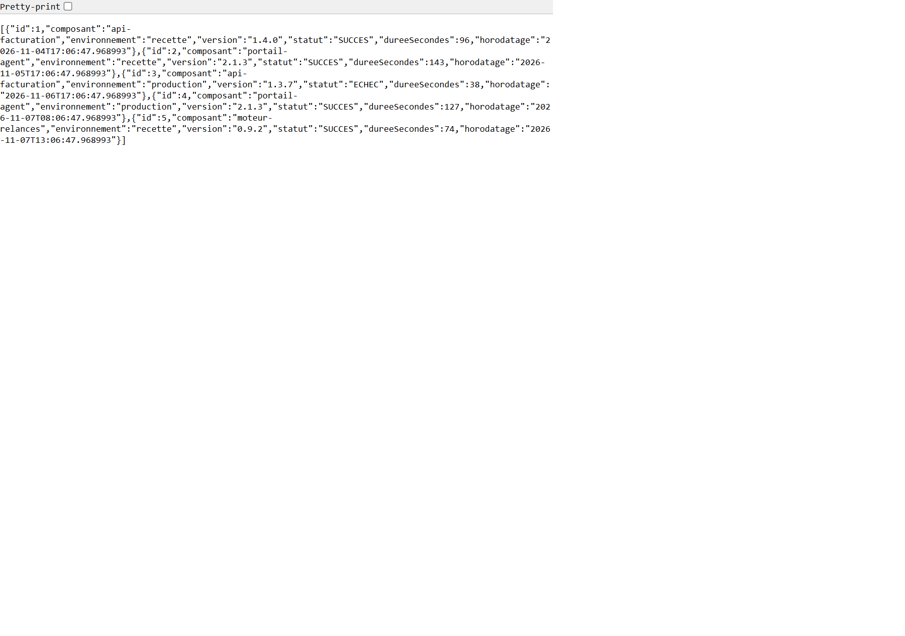
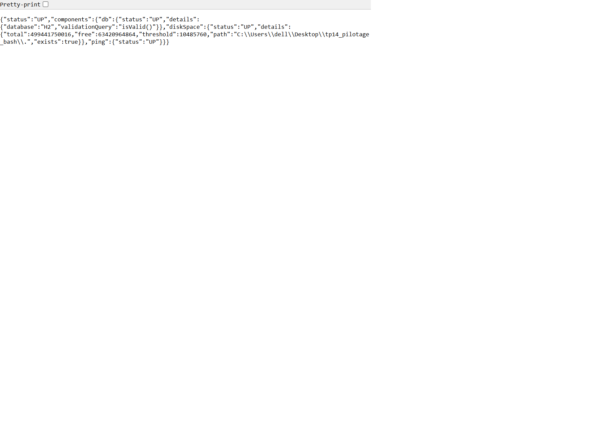
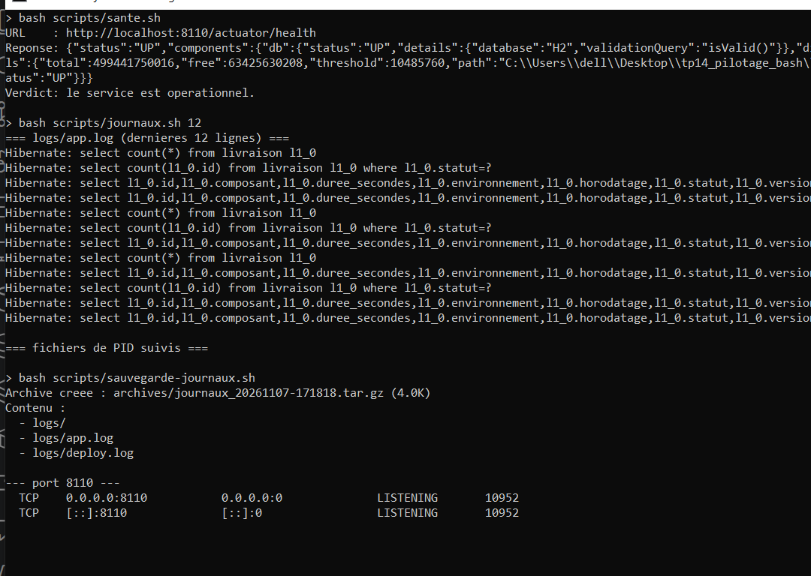
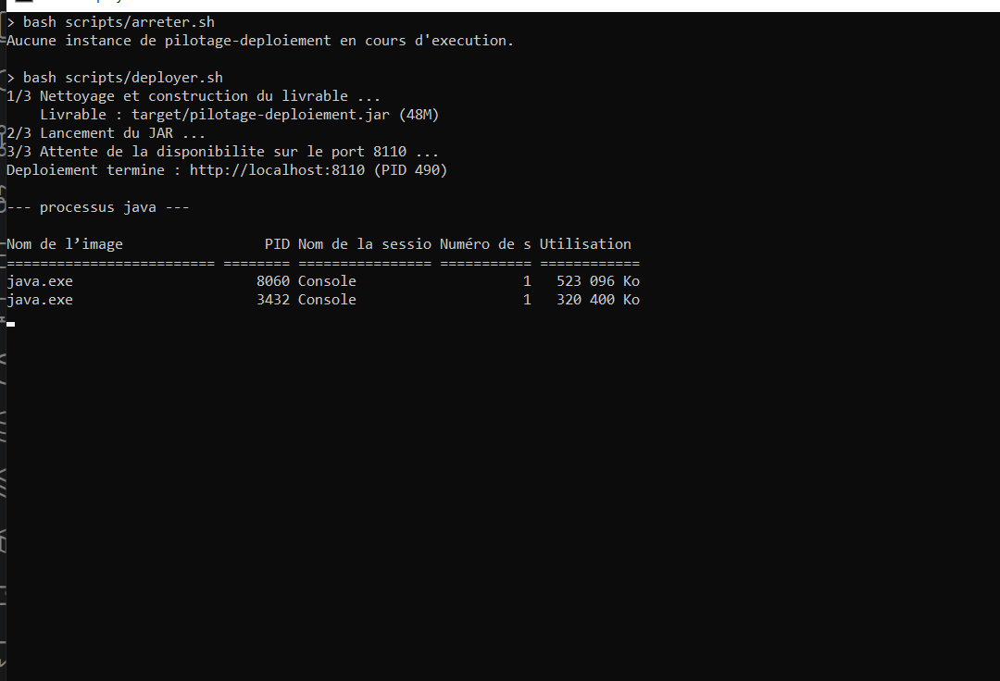
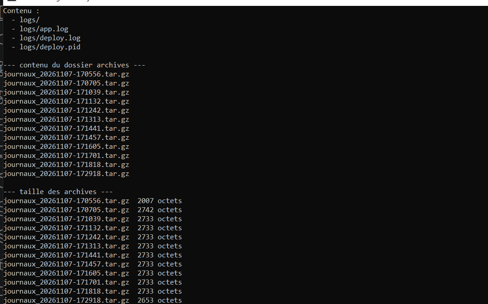

# TP 14 — Automatisation et déploiement Spring Boot avec Bash


## Lancer le projet

Depuis un terminal Bash, à la racine du projet :

```bash
chmod +x scripts/*.sh

# 1. mode developpement (Maven)
./scripts/demarrer.sh
./scripts/sante.sh
./scripts/journaux.sh 20

# 2. mode production (JAR)
./scripts/arreter.sh
./scripts/deployer.sh
./scripts/sauvegarde-journaux.sh

# 3. arret
./scripts/arreter.sh
```

Application : <http://localhost:8110> — Santé : <http://localhost:8110/actuator/health>

### Sous Windows avec Git Bash

Ouvrir **Git Bash** (pas PowerShell), puis exporter Java et Maven si nécessaire :

```bash
export JAVA_HOME="/c/Program Files/Java/jdk-21"
export PATH="$JAVA_HOME/bin:/c/Users/<utilisateur>/tools/apache-maven-3.9.9/bin:$PATH"
```

Certains scripts détectent tout seuls `mvn` ou `mvn.cmd` (`command -v`). Sous MSYS,
`kill -9` n'arrête pas toujours un processus Windows natif : `arreter.sh` complète donc
avec `taskkill //F //PID`.

## Résultats obtenus

### 1. Tableau de bord de l'application démarrée



Après `./scripts/demarrer.sh`, l'application répond sur le port **8110**. Le tableau de
bord affiche les trois compteurs calculés par `/api/registre/synthese` — 5 livraisons
enregistrées, 4 réussies, 96 secondes de durée moyenne — et le détail des cinq livraisons
avec un badge vert pour les succès et rouge pour l'échec.

### 2. API REST des livraisons



`GET /api/registre/livraisons` renvoie le JSON complet des cinq livraisons triées par
horodatage. C'est cette réponse que le tableau de bord consomme en JavaScript.

### 3. Sonde de santé Actuator



`/actuator/health` expose l'état de la base H2, de l'espace disque et du ping applicatif.
C'est la cible du script `sante.sh`, qui cherche la chaîne `"status":"UP"` et renvoie
le code de sortie 0 quand le service est opérationnel (utilisable tel quel dans un cron
ou dans un pipeline).

### 4. Scripts de supervision exécutés pour de vrai



Fenêtre de console réelle : `sante.sh` affiche l'URL interrogée, la réponse brute et son
verdict, puis `journaux.sh` affiche les dernières lignes de `logs/app.log` et l'état du
fichier de PID. On y voit la ligne `Started PilotageApplication in 6.61 seconds` et
`Tomcat started on port 8110`.

### 5. Cycle complet arrêt → déploiement du JAR



`arreter.sh` arrête l'instance Maven, `deployer.sh` nettoie et recompile le projet
(`mvn -B -q clean package -DskipTests`), affiche la taille du livrable produit, lance
`nohup java -jar target/pilotage-deploiement.jar` et attend que le port réponde avant
d'annoncer `Deploiement termine`. Le `tasklist` final confirme qu'un seul processus
`java.exe` sert l'application.

### 6. Sauvegarde horodatée des journaux



`sauvegarde-journaux.sh` crée `archives/journaux_AAAAMMJJ-HHMMSS.tar.gz`. La capture
montre l'archive créée, son contenu (`logs/app.log`, `logs/deploy.log`, les fichiers de
PID), la taille de chaque archive déjà présente et la liste des scripts du projet.

Les sorties texte complémentaires (arborescence, réponses JSON, contenu des archives)
sont conservées dans [`docs/captures/`](docs/captures).

